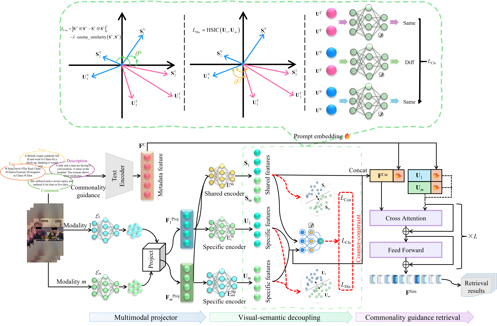

# HCD-Meta
This repository provides a dataset of short videos about homogeneous content.

## Introduction
Specifically designed for homogenization recognition, the self-built HCD-Meta covers a wide range of video topics with metadata.

## Download the dataset
The dataset is available for non-commercial research purposes only. All copyrights of the images and multimedia resources remain with their original owners. Access to the dataset requires a signed data license agreement. Please contact the corresponding author via email for further information.
The associated paper is under review. The source code is currently being prepared.

## Cite this repository
If you use this software in your work, please cite it using the following metadata.
Jiacheng Yao, Jing Zhang, Ze Li, and Li Zhuo. (2023). HCD-Meta by BJUT-AI&VBD [Computer software]. https://github.com/BJUT-AIVBD/hcd-meta

